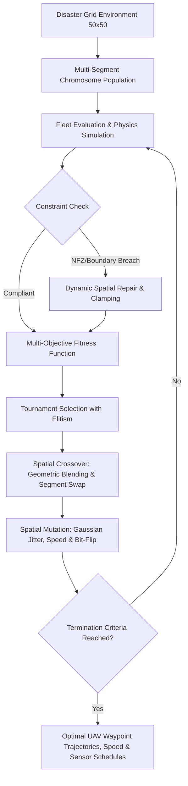

# Autonomous UAV Fleet Surveillance Strategy Engine for Disaster Management
## Multi-Objective Optimization via Genetic Algorithms (GA)


---

## 1. Project Overview & Problem Statement
In disaster response scenarios (e.g., post-earthquake devastation, chemical leaks, floods, or active wildfires), autonomous Unmanned Aerial Vehicles (UAVs) provide vital real-time reconnaissance and survivor localization. However, mission planners face a **multi-objective optimization landscape** with conflicting physical and environmental constraints:
- **Maximization of Area Coverage & Target Detection:** Prioritizing high-value survivor clusters and critical infrastructure sectors.
- **Minimization of Energy Expenditure:** Limiting aerodynamic propulsion draw and sensor electrical load to preserve battery reserves.
- **Minimization of Mission Makespan (Time):** Expediting intelligence delivery for rapid emergency intervention.
- **Minimization of Environmental Hazard Exposure:** Routing UAVs away from severe wind shear, toxic smoke, and radiation pockets.
- **Dynamic Constraint Handling:** Enforcing strict zero-tolerance No-Fly Zones (NFZs) and battery capacity thresholds.

Unlike traditional single-objective algorithms, there is no single rigid solution. This repository provides a modular, object-oriented **Strategy Engine** powered by a tailored **Genetic Algorithm (GA)** featuring custom multi-segment chromosome encodings, specialized spatial genetic operators, and dynamic repair mechanisms.

---

## 2. System Architecture & Methodology



### 2.1 Multi-Segment Chromosome Representation
A candidate fleet mission plan is encoded as a hybrid multi-segment chromosome for $N$ UAVs across $K$ waypoints:

$$\mathcal{C} = \Big\{ \mathbf{W} \in \mathbb{R}^{N \times K \times 2}, \; \mathbf{V} \in \{1, 2, 3\}^{N \times (K+1)}, \; \mathbf{S} \in \{0, 1\}^{N \times K} \Big\}$$

1. **Spatial Waypoint Segment ($\mathbf{W}$):** 
   Continuous 2D coordinates $(x, y) \in [0, 50] \times [0, 50]$ defining navigation waypoints between launch pad $(0, 0)$ and return to base.
2. **Speed Profile Segment ($\mathbf{V}$):** 
   Discrete speed selections ($v \in \{1.0, 2.0, 3.0\}$ cells/s) for each flight leg. Higher speed minimizes flight time at the expense of non-linear kinetic energy consumption ($E \propto v^2$).
3. **Sensor Activation Segment ($\mathbf{S}$):** 
   Binary power schedule ($s \in \{0, 1\}$). Sensors powered ON perform active radar/optical scanning within radius $R_{sensor} = 4.0$ cells; sensors powered OFF during transits conserve crucial battery energy.

---

### 2.2 Mathematical Formulation of Fitness Function
The multi-objective evaluation maps competing factors into a scalar objective with severe penalty barriers for constraint violations:

$$\text{Fitness}(\mathcal{C}) = w_{cov} \cdot C_{score} - w_{energy} \cdot E_{total} - w_{time} \cdot T_{mission} - w_{hazard} \cdot H_{exposure} - \mathcal{P}_{violations}$$

Where:
- **$C_{score}$:** Aggregate disaster priority score of all unique grid cells scanned by the fleet:
  $$C_{score} = \sum_{(x,y) \in \bigcup \text{Footprint}(UAV_i)} \text{Priority}(x, y)$$
- **$E_{total}$:** Cumulative propulsion and sensor energy consumption across all drones:
  $$E_{total} = \sum_{d=1}^{N} \sum_{leg} \Big[ L_{leg} \cdot (c_{base} + c_v \cdot v^2) \cdot (1 + \mu_h \cdot \bar{h}_{leg}) + s_{leg} \cdot P_{sensor} \cdot t_{leg} \Big]$$
- **$T_{mission}$:** Fleet makespan (maximum mission duration among all UAVs):
  $$T_{mission} = \max_{d \in \{1..N\}} \sum_{leg} \frac{L_{leg}}{v_{leg}}$$
- **$H_{exposure}$:** Cumulative environmental risk (wind turbulence, radiation exposure):
  $$H_{exposure} = \sum_{d=1}^{N} \sum_{leg} \bar{h}_{leg} \cdot t_{leg}$$
- **$\mathcal{P}_{violations}$:** Dynamic penalty barrier enforcing zero NFZ collisions and battery headroom:
  $$\mathcal{P}_{violations} = \lambda_{NFZ} \cdot N_{NFZ\_collisions} + \lambda_{batt} \cdot \sum_{d=1}^N \max(0, E_d - E_{max})$$

---

### 2.3 Tailored Genetic Operators
- **Selection:** Tournament selection ($k=3$) combined with strict **Elitism ($E=2$)**, preventing premature genetic drift while preserving elite routes.
- **Crossover:**
  - *Geometric Waypoint Blending:* Produces interpolated spatial coordinates between parent paths:
    $$w_{child} = \alpha \cdot w_{p1} + (1 - \alpha) \cdot w_{p2}, \quad \alpha \sim U(0.2, 0.8)$$
  - *Segment Swapping:* Exchanges sub-tours between drones to combine high-performing local search trajectories.
  - *Uniform Velocity & Sensor Crossover:* Exchanges speed and sensor genes independently.
- **Mutation:**
  - *Spatial Gaussian Jitter:* Perturbs coordinates: $\Delta x, \Delta y \sim \mathcal{N}(0, \sigma^2)$ ($\sigma = 3.5$ cells).
  - *Waypoint Reordering Swap:* Inverts waypoint visit order to untangle self-intersecting loops.
  - *Categorical Mutation:* Bit-flips sensor states ($0 \leftrightarrow 1$) and mutates velocity levels.
- **Constraint Handling (Repair Operator):** Clamps coordinates to valid mission boundaries and actively shifts waypoints situated inside No-Fly Zones to the nearest obstacle-free coordinate before evaluation.

---

## 3. Repository Structure

```
uav_disaster_ga/
│
├── config.py                 # Mission parameters, physical constants & GA hyperparameters
├── environment.py            # 50x50 2D Discretized grid, hazard fields, and NFZ definitions
├── chromosome.py             # Hybrid multi-segment chromosome class & trajectory decoders
├── genetic_algorithm.py      # Core GA engine (Tournament, Crossover, Mutation, Repair)
├── baseline_random.py        # Random Search baseline optimizer for rigorous benchmarking
├── visualizer.py             # Publication-ready Matplotlib plotting and mapping routines
├── main.py                   # Single GA run demonstration script with console metrics
├── run_experiments.py        # Full experimental suite (GA vs Random + Sensitivity Analysis)
├── requirements.txt          # Python dependencies (numpy, matplotlib)
└── README.md                 # System documentation & technical guide
│
└── outputs/                  # Auto-generated visualization assets & benchmark summaries
    ├── fitness_convergence.png
    ├── final_flight_paths.png
    ├── generational_evolution.png
    ├── baseline_comparison.png
    ├── hyperparameter_sensitivity.png
    ├── experiment_results.json
    └── experiment_summary.txt
```

---

## 4. Installation & Setup

### Prerequisites
- Python 3.10, 3.11, or 3.12
- `pip` package manager

### 1. Clone or Navigate to Repository
```bash
git clone <your-repo-link>
cd uav_disaster_ga
```

### 2. Install Dependencies
```bash
pip install -r requirements.txt
```

---

## 5. Execution Guide

### Option A: Standard Single Simulation
To execute the primary Genetic Algorithm optimization and visualize the resulting fleet trajectory:
```bash
python main.py
```
*Outputs generated in `outputs/`:*
- `fitness_convergence.png`: Best vs. Average fitness and multi-metric progression.
- `final_flight_paths.png`: 2D operational disaster map displaying UAV routes, sensor active sweeps, hazards, and NFZs.
- `generational_evolution.png`: Trajectory progression across Gen 1, Mid-Gen, and Final Gen.

### Option B: Comprehensive Experimentation Suite
To run the full suite required for the **Technical Report** (including Random Search benchmark and hyperparameter sensitivity curves):
```bash
python run_experiments.py
```
*Outputs generated in `outputs/`:*
- `baseline_comparison.png`: Direct performance comparison of GA vs. Random Search.
- `hyperparameter_sensitivity.png`: 3-panel sensitivity curves evaluating Population Size, Mutation Rate, and Tournament Pressure.
- `experiment_results.json`: Raw numerical metrics for every experiment.
- `experiment_summary.txt`: Ready-to-copy summary tables and comparative analysis.

### Option C: Compile Publication-Quality PDF Report
To generate the formal 5-page PDF Technical Report with all figures, equations, and tables embedded:
```bash
python generate_pdf_report.py
```
*Output generated:* `UAV_Disaster_Management_Technical_Report.pdf` (5-page submission document).

---

## 6. Generated Visualizations Overview

| Output File | Description |
| :--- | :--- |
| **`fitness_convergence.png`** | Demonstrates fitness growth, priority coverage saturation, and energy stability. |
| **`final_flight_paths.png`** | High-contrast map detailing UAV flight paths, sensor radius sweeps, hazard avoidance, and NFZ clearance. |
| **`generational_evolution.png`** | Visual progression demonstrating how random chaotic trajectories evolve into organized fleet sweeps. |
| **`baseline_comparison.png`** | Empirically proves GA superiority over uniform random sampling under identical evaluation budgets. |
| **`hyperparameter_sensitivity.png`** | Analyzes the sensitivity of varying population size ($N$), mutation rate ($P_m$), and tournament size ($k$). |

---

## 7. License & Credits
Developed as an AI Engineering Team project for Autonomous UAV Disaster Management & Multi-Objective Optimization. Released under the MIT License.
