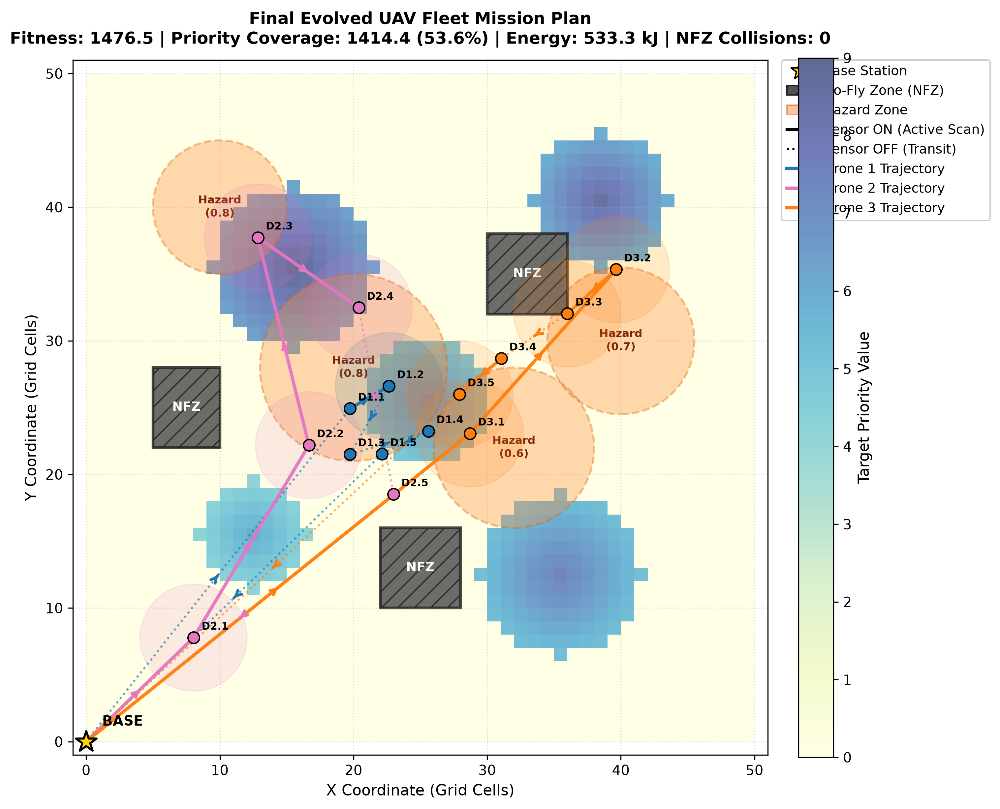
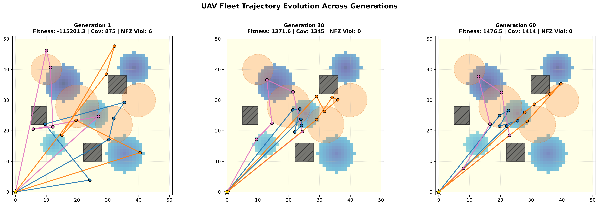
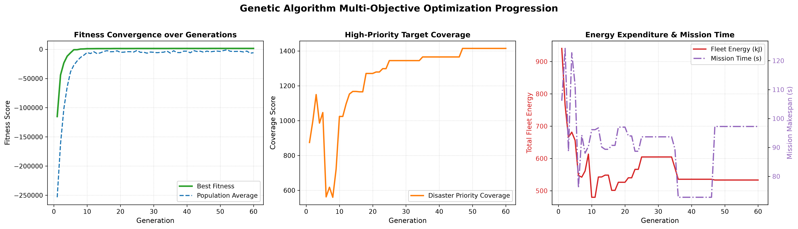
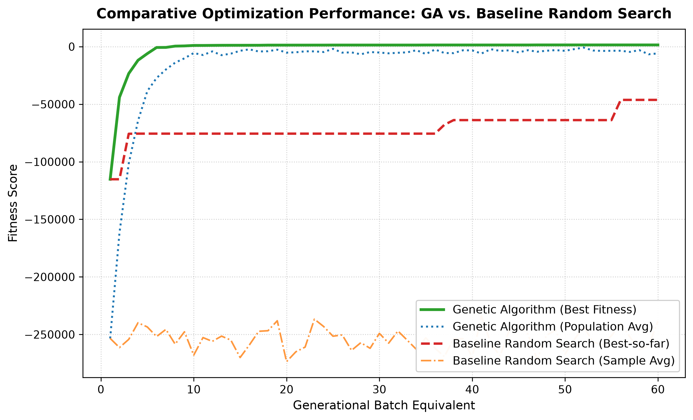
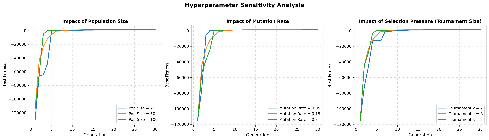

# Autonomous UAV Fleet Strategy Engine for Disaster Management
> Multi-Objective Genetic Algorithm (GA) for autonomous drone fleet path planning, speed selection, and sensor scheduling on a 50x50 disaster grid.

---

## 📌 Project Overview
In disaster response scenarios, autonomous UAV fleets must quickly locate victims while managing tight battery constraints and avoiding dangerous environments. 

This project implements an AI Strategy Engine using a customized Genetic Algorithm (GA) to optimize a fleet of **3 UAVs** over a **50x50 hazard grid**. The engine balances four competing operational goals:
1. **Maximize Coverage:** Scans high-priority disaster clusters.
2. **Minimize Energy:** Reduces motor propulsion draw and sensor power consumption.
3. **Minimize Mission Time:** Completes reconnaissance in the shortest flight makespan.
4. **Avoid Hazards & No-Fly Zones:** 100% collision-free navigation around restricted obstacles and toxic smoke pockets.

---

## 🧬 How It Works

### 1. Hybrid Chromosome
Each candidate solution encodes the entire fleet using three intuitive segments:
* **Waypoints (Continuous $x, y$):** 5 coordinates per drone inside `[0, 49]`. Continuous coordinates allow smooth turns around obstacles.
* **Speed Profile:** Speeds of `1.0`, `2.0`, or `3.0` cells/s per leg. Higher speeds cover distance faster but consume battery non-linearly ($E \propto v^2$).
* **Sensor Schedules:** Binary `1` (ON, 4-cell scan radius) or `0` (OFF, standby mode to save battery across transit paths).

### 2. Multi-Objective Fitness
$$\text{Fitness} = (\text{Coverage}) - (\text{Energy}) - (\text{Flight Time}) - (\text{Hazard Exposure}) - \text{Penalties}$$
* **Redundant Scan Elimination:** Overlapping scans yield zero extra points, forcing drones to explore separate sectors.
* **Two-Tier Constraint Handling:** Invalid coordinates landing in obstacles are proactively repaired to the nearest free cell. Any flight leg clipping a No-Fly Zone receives a severe penalty (-600 pts).

---

## 📊 Visual Results & Outputs

### 1. Evolved UAV Fleet Flight Paths
The 3 UAVs diverge cleanly from base `(0, 0)` into separate sectors with **zero obstacle crashes**:
* **Drone 1 (Blue):** Navigates around the western obstacle to cover the Northwest survivor zone.
* **Drone 2 (Pink):** Sweeps the Northeast disaster cluster while maintaining safe clearance from restricted airspace.
* **Drone 3 (Orange):** Covers the Southern cluster and powers sensors OFF during transit home to conserve battery.

<p align="center">
  
</p>

---

### 2. Generational Evolution
Shows how the fleet transitions from completely random paths to organized, obstacle-free reconnaissance:
* **Generation 1:** Chaotic random paths with 6 No-Fly Zone collisions.
* **Generation 30:** Drones partition the map into distinct operational corridors.
* **Generation 60:** Clean, coordinated multi-drone sweeps with 0 collisions.

<p align="center">
  
</p>

---

### 3. Fitness Convergence & Energy Trends
The fleet clears all penalties within the first 10 generations, stabilizing at **533 kJ** of energy and a **97-second** mission completion time.

<p align="center">
  
</p>

---

### 4. Genetic Algorithm vs. Baseline Random Search
Under an identical budget of 3,000 evaluations, Random Search fails completely due to repeated collisions and battery overruns, while the GA achieves optimal fitness.

<p align="center">
  
</p>

| Metric | Genetic Algorithm Engine | Baseline Random Search | Performance Advantage |
| :--- | :---: | :---: | :--- |
| **Best Fitness Score** | **+1,476.52** | -46,261.57 | **+47,738 pts (GA Superior)** |
| **Priority Coverage** | 1,414.40 pts | 1,464.23 pts | Coordinated sweep vs uncontrolled |
| **Total Fleet Energy** | **533.27 kJ** | 748.52 kJ | **28.8% Energy Saved** |
| **Mission Flight Time** | **97.25 s** | 128.10 s | **24.1% Faster Completion** |
| **Obstacle (NFZ) Collisions** | **0 (Zero)** | 6 Collisions | **100% Collision-Free Safety** |
| **Battery Overrun** | **0.00 kJ (Safe)** | 88.52 kJ Overdraft | Drones return safely to base |
| **Runtime** | **9.44 s** | 11.90 s | GA converges 20.7% faster |

---

### 5. Hyperparameter Sensitivity Analysis
Evaluates the impact of varying Population Size, Mutation Rate, and Tournament Selection Pressure:

<p align="center">
  
</p>

* **Population Size (20, 50, 100):** $N = 50$ offers the best trade-off between population diversity and fast runtime (<10 s).
* **Mutation Rate (0.05, 0.15, 0.30):** $P_m = 0.15$ strikes the optimal balance between spatial exploration and path refinement.
* **Selection Pressure ($k = 2, 3, 5$):** Tournament size $k = 3$ ensures steady elitist progress without premature gene pool homogenization.

---

## 📁 Repository Structure

```text
uav_disaster_ga/
│
├── config.py                 # Mission parameters, grid specs, and GA hyperparameters
├── environment.py            # 50x50 grid map, hazard fields, and No-Fly Zones (NFZs)
├── chromosome.py             # UAVChromosome hybrid encoding & trajectory decoding
├── genetic_algorithm.py      # Core GA engine (Selection, Crossover, Mutation, Repair)
├── baseline_random.py        # Random Search baseline optimizer for benchmarking
├── visualizer.py             # Matplotlib visualizer for route maps and convergence curves
├── main.py                   # Single GA simulation run script
├── run_experiments.py        # Automated test suite (GA vs. Random + Sensitivity Analysis)
├── requirements.txt          # Python dependencies (numpy, matplotlib)
│
└── outputs/                  # Auto-generated experiment visual graphs
    ├── final_flight_paths.png
    ├── generational_evolution.png
    ├── fitness_convergence.png
    ├── baseline_comparison.png
    ├── hyperparameter_sensitivity.png
    ├── experiment_results.json
    └── experiment_summary.txt
